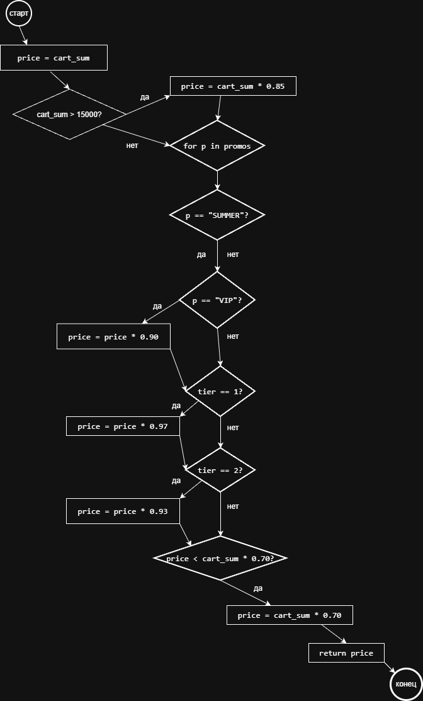

# lab1-comprehensive--
# Итоговый аналитический отчет (Лабораторная работа №1)

## 1. Резюме (Executive Summary)
В рамках работы спроектирован процесс разработки микросервиса «Расчет корзины и скидок». Выбран стек технологий (PostgreSQL), настроен репозиторий и модель ветвления, внедрён CI-контроль качества (flake8 + GitHub Actions), проведено обратное проектирование legacy-алгоритма и составлен план code-review. Настроенные процессы позволяют отлавливать ошибки на ранних этапах и снижают риски внесения дефектов.

## 2. Сравнительный анализ технологий

### 2.1. Матрица принятия решений
| Критерий | Вес | PostgreSQL | MongoDB |
|---|---|---|---|
| Поддержка ACID-транзакций | 0.35 | 5 | 2 |
| Производительность чтения истории | 0.2 | 4 | 5 |
| Гибкость схемы | 0.25 | 3 | 5 |
| Стоимость владения| 0.2 | 4 | 4 |
| **Итого** | **1.00** | **4.1** | **3.75** |

### 2.2. Расчет и обоснование выбора
Формула: `Оценка = Σ (Вес_критерия × Балл_кандидата)`
* **PostgreSQL:** 0.35×5 + 0.2×4 + 0.25×3 + 0.2×4 = **4.1**
* **MongoDB:** 0.35×2 + 0.2×5 + 0.25×5 + 0.2×4 = **3.75**

Победитель — **PostgreSQL (4.1 против 3.75)**. Обоснование: для хранения финансовых транзакций, баллов и промокодов критичны поддержка ACID и строгая целостность данных. Гибкость схемы MongoDB не компенсирует риски потери консистентности.

## 3. Архитектура и контроль версий

### 3.1. Настройка репозитория
Модель ветвления: `main` → `develop` → `feature/*`.
Ссылка на репозиторий: https://github.com/alinakharitonova2009-bit/lab1-comprehensive--

### 3.2. Контроль доступа
Для ветки `develop` настроена защита (требование Pull Request перед слиянием). 
Содержимое файла `.github/CODEOWNERS`:
```text
*@alinakharitonova2009-bit
```
## 4. Инструментальный контроль качества

### 4.1. Настройка CI/CD
Ссылка на файл workflow: https://github.com/alinakharitonova2009-bit/lab1-comprehensive--/blob/feature/qa-gates/.github/workflows/qa.yml
Настроен автоматический запуск линтера flake8 при создании Pull Request в ветку `develop`.

### 4.2. Работа Quality Gate
Был проведен тест «Сломать и починить». При добавлении кода с намеренными ошибками пайплайн упал (красный статус). После исправления кода пайплайн прошел успешно (зеленый статус).

**Текст ошибки линтера при первой проверке:**
`src/discount.py:1:1: F401 'os' imported but unused`

**Описание исправления:** 
Удален неиспользуемый импорт `os`, код приведен в соответствие с PEP 8. Сделаны коммиты `test: add code with intentional errors` и `fix: resolve linter errors`.

## 5. Обратное проектирование и планирование ревью

### 5.1. Анализ алгоритма


Выявленные "запахи кода" (Code Smells) в legacy-фрагменте:
1. **Магические числа:** В коде используются числа без объяснения (15000, 0.85, 500, 0.90, 0.97, 0.93, 0.70). 
2. **Отсутствие валидации:** Функция не проверяет входные данные (например, отрицательную сумму корзины).
3. **Смешение логики:** В одной функции смешана логика базовой скидки, промокодов и уровней лояльности.
4. **Нет обработки исключений:** Неизвестные промокоды просто игнорируются.

### 5.2. План code-review
Ссылка на открытый Pull Request с файлом `docs/review-plan.md`: https://github.com/alinakharitonova2009-bit/lab1-comprehensive--/pull/4

В плане ревью зафиксированы:
- **Цели:** точность расчетов, защита от фрода, корректность применения скидок.
- **Измеримые критерии:** отсутствие магических чисел, валидация входных данных, покрытие тестами > 80%.
- **Эскалация:** комментарии PR -> созвон с Tech Lead -> решение владельца продукта -> фиксация в ADR.

## 6. Заключение
Настроенные процессы (защита ветки, обязательный PR, CI-линтер, план ревью) снижают риск внесения дефектов за счет раннего автоматического контроля, обязательного человеческого ревью и документирования архитектурных решений.
